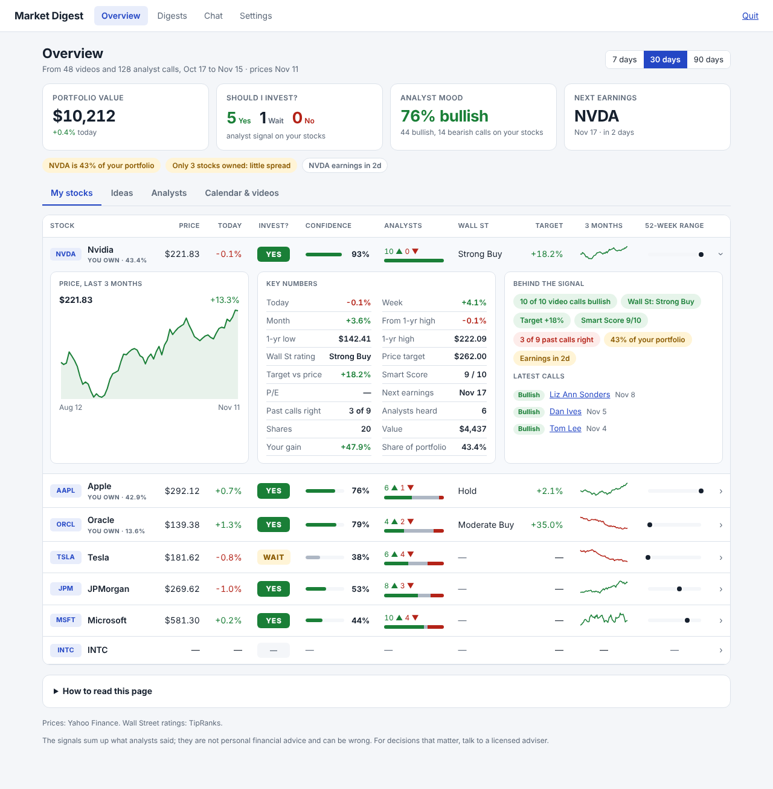

# Market Digest

> **Two versions live in this repository.**
> - **The cloud version** (`cloud/`): one hosted website for every customer. Sign in with Google, pick your stocks,
>   done. This is the product going forward. Start at **[cloud/README.md](cloud/README.md)**; to put it online,
>   **[docs/DEPLOY.md](docs/DEPLOY.md)**.
> - **The desktop version** (`app/`, described below): runs on one person's own computer with their own keys.

**Should I invest? A Yes / No signal for each of your own stocks, every morning, from what the analysts are saying.** Market Digest reads the finance
YouTube channels you follow, checks each of your stocks against what the analysts said, how good their calls have
been, Wall Street's rating (TipRanks) and the price from **Google Finance**, and shows it all on one clear page that
needs no finance background.

It runs on **your own computer** (Windows or Mac). Your stocks stay in your own Google account and on your computer;
there is no Market Digest server. The only online services are the ones that do the thinking and the prices:
Google Gemini (free key), Google Finance, and optionally TipRanks.

*(Example data.)*

What you see:

- **Overview**: your stocks in one table, like a Google Finance watchlist, each with **Invest? Yes / No / Wait**,
  a **confidence** percentage, the analysts' bullish and bearish calls, Wall Street's rating and price target, a
  price chart and the 52-week range. Click a stock for its key numbers and the facts behind the signal. More tabs:
  **Ideas** (most-discussed stocks you do not have), **Analysts** (whose calls have been right), **Calendar**.
- **Your stocks from Google Finance**: connect Google and your stocks live in a sheet in your own Drive, priced by
  Google Finance; edit it there or in the app. Or type them in, or import your current tracker.
- **Daily, weekly and monthly digests**: on screen, in your browser and by email if you like (just your address, no
  password), every point linked to the moment in the video where it was said.
- **Only the analysts you follow**, **a chat** about the videos, and **Claude** connected to your own data.

Market Digest sums up what analysts said and what prices did, to help you decide. It is not investment advice.

## Quick start (Windows or Mac)

All you need is a free **Gemini key**; the setup page has a button that gets it. Nothing else to install: the
installer brings Python if the computer has none (Windows and Mac). Email is optional and needs only your address.

1. Get the files: unzip `market-digest-setup.zip`, or on GitHub click **Code > Download ZIP** (or `git clone` it).
2. Double-click the installer in that folder: **`install.bat`** on Windows, **`install-mac.command`** on a Mac.
   - Windows says "Windows protected your PC"? Click **More info > Run anyway**.
   - macOS says it cannot check the file? Right-click it > **Open** > **Open**.
3. **The setup page opens in your browser: about two minutes.**
   1. **Your free Gemini key:** click **Get my free key**, then **Paste my key**. It is checked by itself.
   2. **Your stocks:** on google.com/finance select all of your watchlist or portfolio, copy, and paste it in; Market
      Digest picks out the tickers. Three popular channels (CNBC, Bloomberg, Yahoo Finance) are already chosen.
   3. **Finish:** everything is set to sensible defaults (7:30 each morning, weekly and monthly digests on).
   Then **Save and finish** and **Make my first digest now**.

That's it. Each morning's digest opens in your browser with a notice on screen (email is optional), and
**Market Digest** is on your desktop: it shows whether the last digest worked, holds the settings, has the chat, and
updates itself in one click when a new version is out.

## Everyday use

| I want to... | Do this |
|---|---|
| Read today's digest | It opens by itself when ready (or **Market Digest** > Digests > Recent digests, or the email). |
| Check my stocks | **Market Digest** opens on the **Overview**: Invest? Yes / No / Wait, with a confidence, for each stock you own or watch. Click a stock for its numbers. |
| See how the analysts' calls are doing | **Overview > Analysts** (7, 30 or 90 days). |
| Weekly and monthly summaries | Arrive by themselves on Saturdays and on the 1st (Settings > How you get the digest). |
| Add my stocks | **Settings > Your stocks** (or your Google portfolio sheet once Google is connected), or **Import from a file**. |
| Know whether it ran, and why not | **Market Digest** > **Digests** shows the last run, in plain words. |
| Change channels, email, keys or time | **Market Digest** > Settings. Each setting has a Test button. |
| Ask about the videos | **Market Digest** > Chat. Or connect the Claude desktop app (Settings > Ask Claude) and ask Claude. |
| Get a digest right now | **Market Digest** > Make today's digest now |
| Check everything works | The **Test** buttons in Settings (or `python digest.py --check` in the program folder) |
| Feed the Econova hub | Each run also saves `video-digest_YYYY-MM-DD.json` in `json_dir` (set it to a Google Drive for desktop folder to share it). See [ARCHITECTURE.md](docs/ARCHITECTURE.md) §3. |
| See prices for my stocks next to the analysts' calls | Add your stocks in Settings; they appear on the Overview. |
| Add past days to the JSON folder | In the program folder: `python <project>\tools\email_backfill.py digests\digest-*.html` (docs/USER_GUIDE.md, 5a) |
| See the dashboard | Open it in Claude (the link is in the Drive folder's START HERE doc). Every number has an (i) that explains it. |
| Add Wall Street's view | Get a key at https://mcp.tipranks.com/ (Keys) and paste it in Settings > TipRanks |
| Update to the newest version | **Market Digest** > Digests > **Update now** (shown when a new version is out; settings are kept) |
| Close it | **Quit** at the top right of the page. The daily digest still runs. |

## Documents

- **[docs/USER_GUIDE.md](docs/USER_GUIDE.md)**: installation, settings, daily use, updating and removing it.
- **[docs/TROUBLESHOOTING.md](docs/TROUBLESHOOTING.md)**: what to do when something goes wrong.
- **[CHANGELOG.md](CHANGELOG.md)**: what changed in each version.
- **[services/email/README.md](services/email/README.md)**: setting up the email service (once, by the developer).
- **[docs/GOOGLE_SETUP.md](docs/GOOGLE_SETUP.md)**: setting up "Connect Google" (once, by the developer).
- **[docs/ARCHITECTURE.md](docs/ARCHITECTURE.md)**: how it works inside, for developers. *(Not in the setup zip.)*
- **[docs/PRESENTATION.md](docs/PRESENTATION.md)**: a 6-slide overview of the project. *(Not in the setup zip.)*

## What is where

| Folder | What it holds |
|---|---|
| `app/` | The program: everything that is installed on a customer's computer (listed in `app/MANIFEST`). |
| `install.bat`, `install.ps1`, `install-mac.command` | The installers. They copy `app/` to the customer's computer and open the setup page. |
| `docs/` | The user guide, troubleshooting, and the developer docs (architecture, Google setup, hub integration). |
| `services/email/` | The email service (a Google Apps Script), deployed once by the developer. |
| `tools/` | Developer tools: `make_package.bat` (builds the setup zip), `price_sheet.py`, `email_backfill.py`, the watchlist template. |
| `tests/` | `python -m unittest` from the project folder. |
| `archive/` | Early prototypes, kept for reference. |

## Good to know

- Captions are automatic and can mishear names and numbers. Unclear figures are marked "(check)", and every point
  links to its moment in the video so you can check it.
- The digest reports what each channel said. **It is not investment advice.**
- The PC must be on for the digest to run. If it was off at the scheduled time, it runs when the PC is next on and
  includes everything since the last digest.
- Web search in the chat needs a Gemini key with billing turned on. On the free key, the chat answers from your
  videos only and says so.
