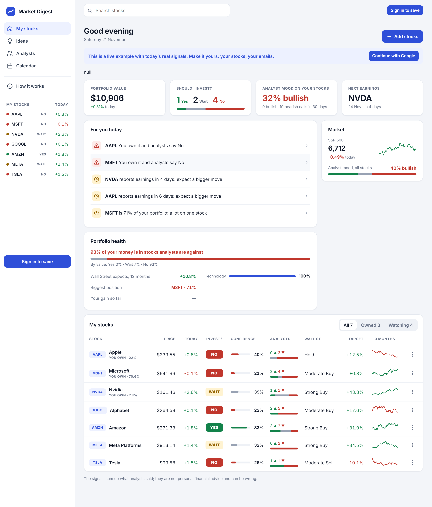

# Market Digest, the cloud version

One hosted product for every customer: they open a website, click **Continue with Google**, pick their stocks, and see
a Yes / No / Wait signal for each, with the numbers behind it. No install, no keys, nothing to configure.

To put it online, follow **[docs/DEPLOY.md](../docs/DEPLOY.md)**. Before charging customers, read
**[docs/BEFORE_LAUNCH.md](../docs/BEFORE_LAUNCH.md)**.



*(Example data: invented analysts and prices.)* More: [the front page](../docs/img/cloud-front.png),
[a stock page](../docs/img/cloud-stock.png), [on a phone](../docs/img/cloud-phone.png).

## How it works

```
 YouTube channels ─┐
 (uploads feed)    │      ┌──────────────── the engine (GitHub Actions, hourly) ───────────────┐
                   ├────► │ 1. new videos → Gemini watches each ONCE → notes (calls, speakers)   │
 Yahoo Finance ────┤      │ 2. prices, once a day a stock                                        │
 TipRanks ─────────┘      │ 3. Wall Street ratings, a few batches a weekday (50 calls a month)   │
                          │ 4. one card a stock: signal, confidence, numbers; the market pages   │
                          │ 5. emails to each user about their own stocks                        │
                          └───────────────────────────────┬──────────────────────────────────────┘
                                                          ▼
                              Firestore:  stocks/  charts/  market/  public/      users/{uid}
                                                          ▲                            ▲
                                                          │ read                       │ read and write own
                              the web app (Firebase Hosting, static) ◄── Google sign-in (Firebase Auth)
```

The expensive work, reading videos, is the same for every user, so it is done once. A user's page is their list
joined with the shared cards; their value, weights and gain are worked out in their browser. The cost of running the
service grows with the number of channels, not the number of users.

## What is where

| Path | What it is |
|---|---|
| `sources.json` | The channels, the analysts to favour, the limits, the starter lists. Edit and commit to change them. |
| `engine/videos.py` | Finds new uploads (YouTube's feed), ranks them, has Gemini watch the link and return notes. |
| `engine/street.py` | TipRanks within the monthly allowance: users' stocks first, then the stalest. |
| `engine/cards.py` | Builds each stock's card and the shared pages (ideas, analysts, calendar, videos). |
| `engine/mail.py` | The daily brief and weekly summary, per user, sent from one address. |
| `engine/run.py` | One run: the steps above in order; writes only what changed. `python -m cloud.engine` |
| `engine/store.py` | Firestore, or a dict in tests. |
| `web/` | The site: no build step, plain JavaScript modules. `js/data.js` talks to Firebase, `js/app.js` and `js/pages.js` are the pages, `js/ui.js` the charts and parts. |
| `firestore.rules` | Who may read and write what. |
| `tools/check.py` | Tries every secret for real ("Check setup" workflow). |
| `tools/make_symbols.py` | Builds the search list at deploy time. |
| `tools/demo_data.py` | Invented data for local work and tests. |
| `tests/live.cjs` | The live site as a visitor sees it before signing in: pages, example stocks, phones, files, headers, what a stranger may read. Changes nothing. |
| `tests/e2e.cjs` | The whole product in a browser against the emulators: 60 checks, the security rules included. |

The signal itself, the scoring of analysts' calls and the notes format are the tested code in `app/`
(`insights.py`, `prices.py`, `tipranks.py`, `digest.py`), which the engine imports.

## The data

| Collection | Written by | Read by | Holds |
|---|---|---|---|
| `stocks/{TICKER}` | engine | members | The card: price, signal, confidence, factors, calls, Wall Street, signal history |
| `charts/{TICKER}` | engine | members | A year of daily closes |
| `market/{page}` | engine | members | `overview`, `analysts`, `calendar`, `videos`, `meta`, `status` |
| `public/demo` | engine | members (anyone, once the beta opens) | The first starter list as it stands today, for the front page |
| `members/{email}` | engine (from the `BETA_MEMBERS` secret) | that address, to check it is in | The private beta: who may use the site |
| `users/{uid}` | that user | that user, engine | Email, name, stocks (with shares and cost if typed), email choices |
| `requests/{TICKER}` | signed-in users | engine | "Start covering this stock" |
| `videos/{id}` | engine | engine | Gemini's notes for each video, written once |
| `mail/{uid}`, `engine/state` | engine | engine | What was sent to whom; the engine's own state |

## Working on it locally

Needs Python 3.9+, Node 18+ and Java (for the emulators). No keys.

```
pip install -r cloud/requirements.txt
cd cloud && npx firebase-tools emulators:start --only auth,firestore,hosting --project demo-md      # leave running
FIRESTORE_EMULATOR_HOST=127.0.0.1:8080 GCLOUD_PROJECT=demo-md python cloud/tools/demo_data.py       # example data
```

Open http://127.0.0.1:5000. "Continue with Google" opens the emulator's own sign-in, where any made-up account works.

```
python -m unittest                 # 168 tests: the desktop app's, and the engine's on invented data
node cloud/tests/e2e.cjs           # 60 checks in a real browser (npm i -g playwright)
node cloud/tests/live.cjs          # the deployed site, signed out (BASE=https://… for another project)
```

## Decisions worth knowing

- **Gemini watches the video link.** YouTube refuses caption downloads from cloud servers (tested from a GitHub
  runner, 16 Nov 2026), so captions are not fetched at all. Low-resolution frames at one every five seconds and a
  20-minute cap keep a video inside the free quota.
- **The signal is calibrated, not counted.** Each analyst gets one vote on a stock (their latest call; turning
  neutral withdraws it), a call loses half its weight every ten days, and well-rated analysts count more. Wall Street's
  rating is weighed in, but most large companies are rated Buy, so a plain Buy is only a mild plus and only Strong Buy
  is a Yes on its own. Confidence is mostly how one-sided the views are: 58 calls split 32/26 is a Wait, not a
  confident Yes. The words under a signal follow the confidence ("clearly" only when it is). See
  `check_stock` and `confidence_pct` in `app/insights.py`.
- **No server of our own.** A static site, Firebase for sign-in and data, and a scheduled job. Nothing sleeps, and
  there is nothing to keep patched.
- **Cards are public to signed-in users, user data is private.** The rules allow a user their own `users/{uid}`
  document and nothing of anyone else's; the engine's records are closed to browsers.
- **Writes are spared.** Each card carries a fingerprint; an unchanged card is not written again. The engine keeps a
  scratch folder between runs (the workflow's cache) and rebuilds it from Firestore when it is gone.
- **Emails go only to the address signed in with.** The rules refuse an account document with any other address.
